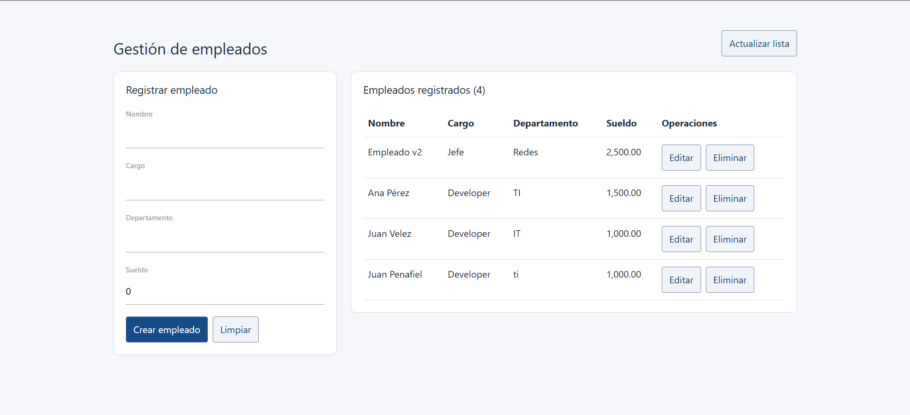

# Práctica 03: Stack MEAN

**Asignatura:** Patrones de Diseño de APIs
**Carrera:** Maestría de Software

## Objetivo

Implementar un sistema de gestión de empleados con MongoDB, Express, Angular y Node.js sobre TypeScript, aplicando separación de responsabilidades, validación y programación reactiva.

## Implementación

La aplicación permite registrar, listar, consultar por ID, actualizar y eliminar empleados. Cada registro contiene nombre, cargo, departamento y sueldo. La API también admite consultas paginadas.

Se desarrollaron los cuatro retos de la guía:

1. **Repository:** interfaz `IEmployeeRepository` e implementación para MongoDB; los controladores no dependen de Mongoose.
2. **DTO y respuesta universal:** esquemas Zod para validar entradas, respuestas uniformes y middleware global de errores.
3. **Estado reactivo:** `EmployeeService` centraliza HTTP y administra el estado con un `BehaviorSubject` privado, observables y actualizaciones inmutables.
4. **Smart y Dumb Components:** un componente orquestador consume el estado con `async`; el formulario y la tabla se comunican mediante `@Input` y `@Output`.

## Ejecución

Con Node.js 20+ y MongoDB disponible, ejecutar en dos terminales desde la raíz del proyecto:

```powershell
# Backend: http://localhost:3000
cd code/backend
npm install
npm run build
npm start
```

```powershell
# Frontend: http://localhost:4200
cd maestria
npm install
npm start
```

La conexión predeterminada es `mongodb://127.0.0.1:27017/usuarios_db`; puede cambiarse mediante la variable de entorno `MONGO_URI`.

## Evidencia

La captura muestra el formulario de registro y cuatro empleados en la tabla, con opciones de edición y eliminación.



## Verificación y conclusión

Ambos proyectos compilaron correctamente. Se aprobaron 6 pruebas del backend y 7 de Angular, que verifican operaciones CRUD, validaciones, manejo de errores y comportamiento reactivo. Las pruebas del backend utilizan un repositorio en memoria; la integración con MongoDB requiere una comprobación independiente.

La solución aplica los cuatro retos de refactorización y mantiene separadas la persistencia, la API, el estado y la presentación.
